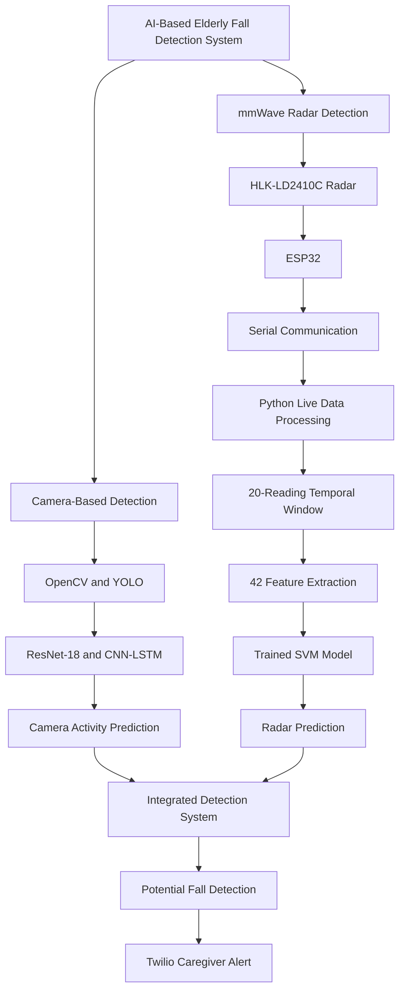

# 🧓 AI-Based Elderly Fall Detection and Alert System

An AI-powered elderly monitoring system that integrates Computer Vision, Deep Learning, mmWave Radar, and Machine Learning to detect potential falls and notify caregivers in real time.

## 📌 Project Overview

The AI-Based Elderly Fall Detection and Alert System is designed to improve elderly safety through intelligent activity monitoring and automated emergency alerts.

The system integrates two detection technologies:

1. **Camera-Based Detection:** Uses Computer Vision and Deep Learning models, including ResNet-18, CNN-LSTM, and YOLO, to analyze human activities and detect potential falls.
2. **mmWave Radar-Based Detection:** Uses an HLK-LD2410C 24 GHz radar sensor connected to an ESP32 to collect live human movement data. A temporal Support Vector Machine (SVM) model analyzes radar readings and classifies activities into NORMAL and FALL.

The integrated detection system processes camera and radar information to identify potential fall events. When a fall is detected, the caregiver alert mechanism uses Twilio to send an emergency notification.

The project also explores abnormal inactivity monitoring with voice prompts and caregiver notification.

## 🎯 Project Objectives

- Develop an intelligent real-time elderly fall detection system.
- Integrate camera-based Computer Vision and radar-based sensing.
- Recognize human activities using Deep Learning.
- Collect and process real-time radar sensor readings.
- Extract temporal features for radar-based classification.
- Implement SVM-based fall detection.
- Integrate automated caregiver notifications.
- Develop a privacy-conscious elderly monitoring solution.

## ✨ Key Features

- 🎥 **Camera-Based Fall Detection:** Analyze video frames using Deep Learning models.
- 📡 **Live mmWave Radar Monitoring:** Detect human presence and movement using a 24 GHz radar sensor.
- 🤖 **AI-Based Activity Recognition:** Recognize activities such as walking, standing, sitting, and lying.
- 🧠 **Temporal SVM Classification:** Analyze radar readings using a 20-reading temporal window and 42 extracted features.
- 🔗 **Integrated Detection:** Combine camera-based and radar-based detection in the monitoring system.
- 🚨 **Emergency Alert System:** Notify caregivers through Twilio when a potential fall is detected.
- ⏱️ **Abnormal Inactivity Monitoring:** Support prolonged inactivity detection and voice-based checking.
- 🔒 **Privacy-Conscious Monitoring:** Reduce dependence on continuous video monitoring by incorporating radar sensing.

## 🛠️ Hardware Components

| Component | Description |
|---|---|
| ESP32 | Microcontroller for radar communication |
| HLK-LD2410C | 24 GHz mmWave radar sensor |
| Camera | Captures video for visual activity analysis |
| USB Cable | Power and serial communication |
| Laptop / Computer | Runs AI models and real-time processing |

### Hardware Connections

**HLK-LD2410C to ESP32**

| HLK-LD2410C Pin | ESP32 Pin |
|---|---|
| VCC | 5V |
| GND | GND |
| TX | GPIO 16 (RX2) |
| RX | GPIO 17 (TX2) |
| OUT | Not connected |

The ESP32 communicates with the computer through USB serial communication.

## 💻 Software Technologies

| Technology | Application |
|---|---|
| Python | Main programming language |
| PyTorch | Deep Learning implementation |
| ResNet-18 | Visual feature extraction |
| CNN-LSTM | Spatial and temporal activity analysis |
| YOLO | Human detection |
| OpenCV | Video processing |
| Scikit-learn | Machine Learning |
| SVM | Radar-based fall classification |
| NumPy | Numerical computation |
| Pandas | Dataset processing |
| Joblib | Loading trained ML models |
| PySerial | Live radar serial communication |
| FastAPI | Backend API |
| Twilio | Caregiver emergency notifications |

## 🏗️ Overall System Architecture

The project consists of two integrated detection pipelines and a common alert mechanism.

### 1. Camera-Based AI Detection

- Capture live video using a camera.
- Process video frames using OpenCV.
- Detect humans using YOLO.
- Extract visual features using ResNet-18.
- Analyze spatial and temporal information using CNN-LSTM.
- Recognize activities such as FALL, WALKING, SITTING, STANDING, and LYING.

### 2. Live mmWave Radar Detection

- The HLK-LD2410C sensor transmits 24 GHz electromagnetic waves.
- Reflected signals provide human presence and movement information.
- ESP32 receives radar data and sends it to the computer.
- Python collects live readings through serial communication.
- A temporal window stores 20 consecutive radar readings.
- The system extracts 42 features from the temporal data.
- The trained SVM model predicts NORMAL or FALL.

### 3. Camera and Radar Integration

- Process camera-based activity predictions.
- Process live radar-based SVM predictions.
- Integrate the outputs within the monitoring system.
- Use the integrated detection results to identify potential fall events.
- Forward detected events to the alert mechanism.

### 4. Caregiver Alert System

- Identify potential fall events.
- Trigger the configured alert mechanism.
- Use Twilio integration to notify caregivers.
- Support faster caregiver response.

## 🔄 Complete System Workflow



## 🧠 Machine Learning and Deep Learning Models

### Camera-Based Detection Models

**ResNet-18**
- Used for visual feature extraction.
- Processes image information for activity analysis.

**CNN-LSTM**
- CNN extracts spatial information from video frames.
- LSTM analyzes temporal information across frames.
- Supports human activity and fall classification.

**YOLO**
- Used for human detection in video frames.
- Supports real-time visual monitoring.

### Radar-Based Machine Learning Model

**Temporal Support Vector Machine (SVM)**

The radar pipeline uses a trained SVM model to classify live radar data.

**Processing steps:**

1. Collect live radar readings.
2. Create a temporal window containing 20 readings.
3. Extract 42 features from the window.
4. Prepare the feature vector in the trained model's expected format.
5. Pass the feature vector to the trained SVM model.
6. Generate the classification result.

**Model input:**
- 20 consecutive radar readings.
- 42 extracted temporal features.

**Model output:**
- NORMAL
- FALL

## 🚨 Caregiver Alert Mechanism

The project integrates Twilio for caregiver notifications.

**Alert workflow:**

1. The integrated detection system identifies a potential fall.
2. The alert module receives the detection event.
3. Twilio integration initiates the configured caregiver notification.
4. The caregiver receives the alert and can respond.

### Abnormal Inactivity Monitoring

The system also supports an inactivity-monitoring workflow:

- Monitor prolonged inactivity.
- Trigger a voice prompt to check whether the elderly person is okay.
- If there is no response, initiate caregiver notification according to the configured logic.

## 📂 Project Structure

```text
Elderly-Fall-Detection/
│
├── camera/
│   ├── fall_detection.py
│   └── activity_recognition.py
│
├── radar/
│   ├── live_radar_prediction.py
│   ├── radar_data_collection.py
│   └── train_live_random_forest.py
│
├── models/
│   ├── best.pth
│   └── live_radar_svm_temporal.pkl
│
├── alerts/
│   └── call_care.py
│
├── dataset/
│
├── requirements.txt
├── .env.example
└── README.md
```

*The structure above is illustrative. Update the filenames and directories to match your actual repository.*

## ⚙️ Installation and Setup

### Step 1: Clone the Repository

```bash
git clone YOUR_GITHUB_REPOSITORY_URL
```

### Step 2: Navigate to the Project

```bash
cd Elderly-Fall-Detection
```

### Step 3: Create a Virtual Environment

```bash
python -m venv .venv
```

### Step 4: Activate the Environment

For Windows:

```bash
.venv\Scripts\activate
```

### Step 5: Install Dependencies

```bash
pip install -r requirements.txt
```

### Step 6: Configure Hardware

- Connect the HLK-LD2410C radar sensor to ESP32.
- Connect ESP32 to the computer through USB.
- Identify the correct serial COM port.
- Configure the baud rate to 115200.
- Connect and configure the camera.

### Step 7: Configure Alert Credentials

Create a `.env` file containing the required Twilio credentials and caregiver contact configuration.

Never upload your actual `.env` file or API credentials to GitHub.

### Step 8: Run the Application

Run the main application or the configured camera, radar, and backend scripts according to your repository's entry point.

## 🔐 Privacy and Safety

- Avoid camera monitoring in bathrooms and other private spaces.
- Use radar sensing as an additional monitoring technology.
- Protect personal information and collected sensor data.
- Secure API credentials and caregiver contact information.
- Treat automated predictions as potential fall indicators requiring human verification.

## 🚀 Future Enhancements

- Improve camera and radar fusion accuracy.
- Reduce false-positive fall predictions.
- Improve real-time detection performance.
- Develop a dedicated caregiver dashboard.
- Add mobile application support.
- Enhance inactivity monitoring and voice interaction.
- Expand testing across different indoor environments.

## ⭐ Conclusion

The AI-Based Elderly Fall Detection and Alert System demonstrates the integration of Artificial Intelligence, Deep Learning, Machine Learning, Computer Vision, and IoT technologies for elderly safety monitoring.

By combining camera-based activity recognition with live mmWave radar sensing and temporal SVM classification, the system aims to improve potential fall detection and support timely caregiver notifications.

This project explores an intelligent and privacy-conscious approach to elderly monitoring using multiple sensing technologies.
